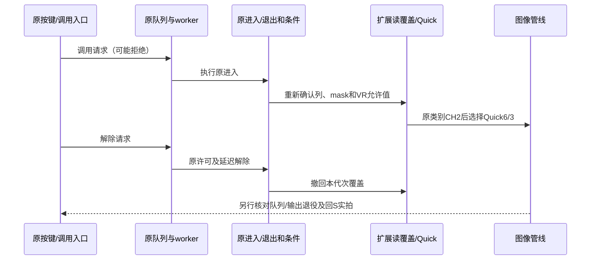

# 移植流程、调用链与验收边界

## 起点与不能直接移植的部分

本包是原Z9 5.32上的定向新增源码，不是完整厂商SDK。5.60/5.61是开发版本标识，不代表同名官方固件地址。Z8、其他Z9版本必须重建自己的原模块SHA、ROM基址、初始化RAM范围、ISA、编译约定、符号和资源配方。不得整体偏移地址、复制原始菜单资源、把当前新增代码放到“搜索未命中”的零区，或沿用另机型的BSS/页表余量。

[内存与ABI](recall-memory-abi.zh-CN.md)列原接口，[机器可读参考](f2-reference.json)绑定当前源码SHA。原菜单正文只从用户自己的精确原模块提取；mark1-menu-recipe.json是copy/作者修改配方，不能把它当另机型模板。

## 原生调用与退出

Z9研究链：40D52598(control)选择列；control0x28选择保持，普通提取AF-ON bit10。40D5668C → 40FBB8B8 → 40FD58DC排队；worker40FBB8FC随后调用40ED2758。历史队列合同为80个0x188槽，槽大小、上下文内容与当前运行所有权必须在移植目标重证；前端返回0或入队成功均不等于已执行。

解除经40FBBA08排队，条件允许后40FCBA2C → 40ED2848；保留原延迟解除state2及原就绪/抑制门。不能由按键松手、getter变化或一帧相同像素推断调用已退出。40ED3488的14项转换涉及AF区域，早期“释放快照”解释已撤回。

## 目标CH2与Quick6/3

原目标S0/CL1/CH2、私有释放0/1/2、Quick C15=6/C30=3不共享编号空间。当前overlay对两列释放目标都输出CH2；原40ED7FA0类别消费者、40ED8190 Quick消费者及其原勾选/活动/抑制条件必须保留。

`recall_quick.S`在两个不同站点读取不同ABI：普通站点目标在W6，原mask在进入挂钩前SP+16；保持站点目标在W9，原mask在SP+56。压栈X9/X10后对应+32/+72。只在原目标CH2且TAG、保留位、VR enum及私有release全部合法时输出Quick；其他情况回原CH或原比较路径。它不是可从任意地方调用的C函数。重新定位每个分支后继和原限制，不能只看到C15/C30字符串就挂钩。

本Z9站点续接：normal compare40ED81C0、hold compare40ED81F8、common40ED81C4、nativeCH40ED81FC。另机型必须重新反汇编和验证寄存器、栈、分支距离及NZCV；这里没有提供Z8替代地址。

## 保存及异步生命周期

原保存服务410DC550处理23字段，含AF区域转换，会将释放归一为原S/CL/CH。扩展只识别两列准确首ID且n=23，保留原23字段并追加mask，提交24字段；无法读出VR/selector/category/selection就拒绝，其他批次原样回原服务。保存当前C15/C30须同时确认selector7、类别1、Quick6/3，不能只读旧1C26。

批处理返回、通知、原银行事务写入、实际NOR内容、冷启动读回是五类不同证据。检查失败返回、不触及另一列、未知tag拒绝、同代次发布和缓存失效。修改私有释放mask后须通知释放目标的原订阅者；只改getter会留下旧缓存。保留原锁/事务/提交先后，不用写“ready”、清busy、伪造完成或额外sleep掩盖未闭环。

调用退出还要考虑原历史、解码、JPEG、接收器/ISP及候选帧槽位。有限状态表的单个完成位不代表所有消费者已退役；PCM或像素相同也不是逐张ID。P1388/P1440只证明特定镜头模型/配方的Fn1保持列路径；普通列、持久化、辅助校正图、满深度预拍及额定帧率不能补算。

## 建议移植顺序

1. 锁定原输入、编译器和空间合同；先能从用户原模块重建目标版本，记录CRC与SHA。
2. 恢复原菜单行/事件/模板尺寸及终止条件；只做有界只读观察，区分工具读取拒绝与固件故障。
3. 恢复DSID/条件/存储编号，原getter/setter/options与23字段保存；逐一验证返回约定和原门槛。
4. 将新结构用目标ABI编译导出，检查锚点、堆分区、页表、RO/RX、cache维护和异步拥有期；启动运行时不是任意可清的BSS。
5. 分别接入普通/保持菜单、纯读取覆盖、通知和Quick；验证未知/legacy、两列隔离、旧S/CL/CH速度子页及原帮助/焦点。
6. 两列分别实际调用/解除/再次调用，核对原活动状态、真实照片和恢复模式；再测真实非易失保存和冷重启。
7. 原版QEMU修复与固件新增功能分账，失败样本保留；只跑必要针对性新案例，不以固定五次或历史样本代替缺失场景。模拟通过不替代设备接受和长期测试。

常见排查：显示正确但速度错误→核对目标/Quick空间及订阅缓存；VR调用中失效→核对options/guard代次而非强写基础VR；菜单空白/花屏→检查widget类型和模板尺寸；保持列重启丢失→核对53而非仅0F；退出不能拍→先核对真实资源退役，不能清状态位强行恢复。第一次移植不叠加CH20声音研究补丁，使输入和因果可追溯。
