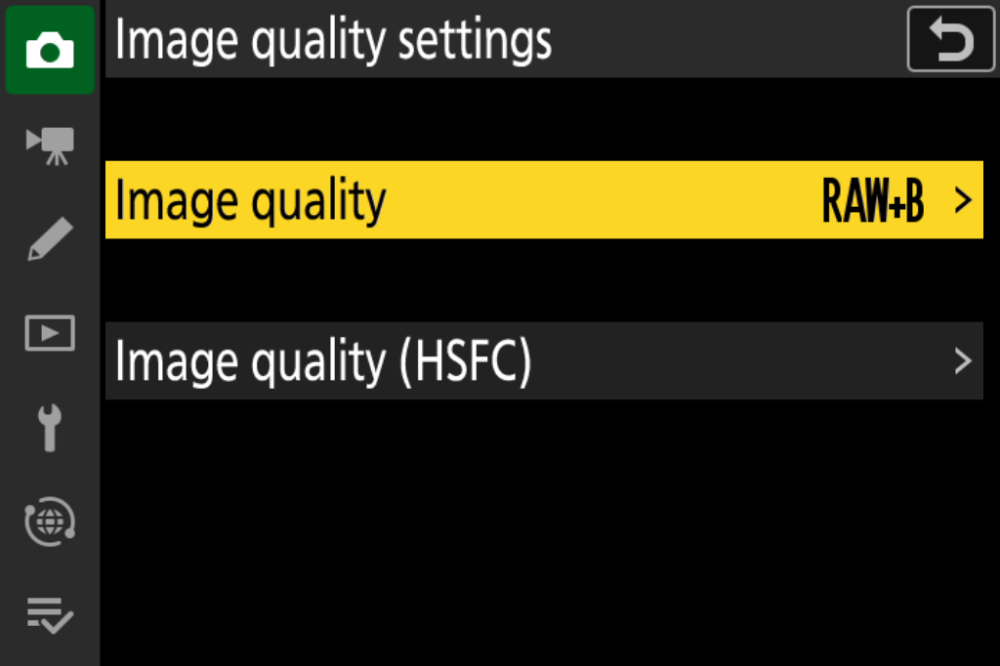
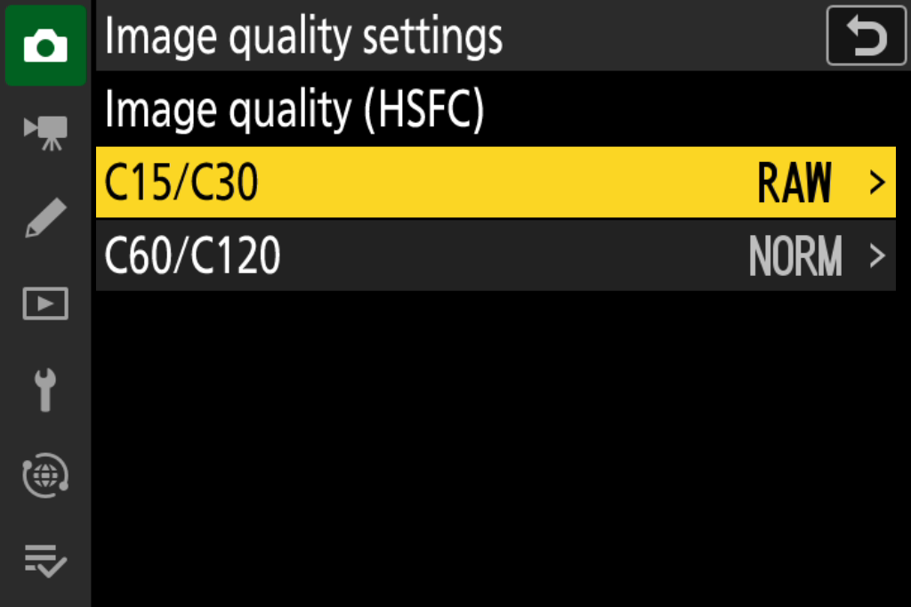
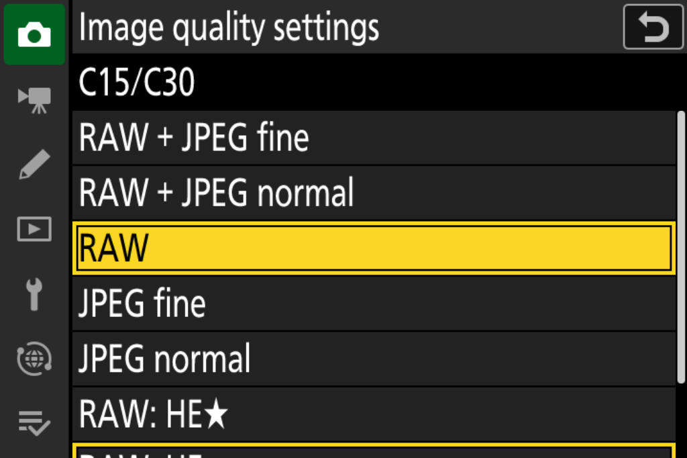
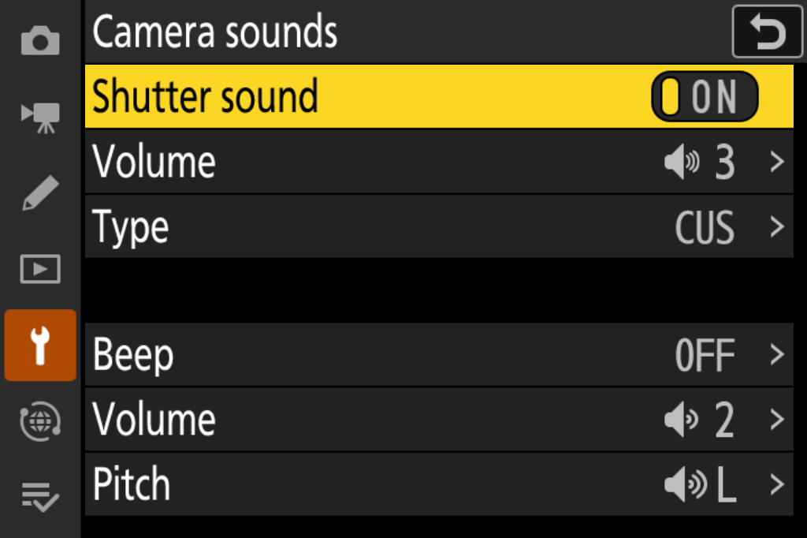

# Z9 mark3 v39 功能与使用手册

## v39 功能与使用手册

Z9 / MARK3 + MARK2

C15 / C30 原生 HE、HE★ RAW

预拍摄、DX 与自定义快门声

> 本手册面向集成 v39。原始代码基线为 Z9 5.32；5.60 是同一业务实现的版本标识重打包。

文档日期：2026-11-05

截图：精确 v39 QEMU 原始 LCD 栅格，英文界面。

菜单操作按中文路径说明；截图未重绘、未叠加虚构选项。

当前实机反馈：v39 重启后的音频菜单正常；C15、C30 RAW 快速裁切执行正常。该反馈不等于所有格式、裁切区域、双卡及长期使用的完整验收。

## 01 版本与功能速查

先确认版本，再按需求选择

| 项目 | v39 行为与边界 |
|---|---|
| C15 / C30 | RAW、RAW+JPEG、JPEG；RAW 编码可选 HE / HE★ |
| JPEG 档位 | C15/C30 仅精细、标准；不提供基本或 JPEG 星级 |
| C60 / C120 | 保留 JPEG 分组与精细/标准选择，不新增 RAW |
| FX / DX | 已接入两种区域；历史有界 QEMU 分项通过，v39 全矩阵仍需实机 |
| 预拍摄 | 沿用原设置；C30 + FX + HE★ + 含 RAW 时上限 0.5 秒 |
| 音频 | 卡内 WAV 选择、CUS、冷启动文件列表与当前项恢复 |
| 机内处理 | 最新用户确认 C15/C30 快速裁切正常；RAW 润饰未获本轮全矩阵反馈 |

发布名与功能版本独立：v39 指功能集；5.32/5.60 指包内版本标识。5.60 只等长改动四处版本字符串，MAIN 实际改动 8 字节，业务逻辑相同。

> 原始 v39 已有用户实机功能反馈。5.60 已通过离线封包及旧升级器函数链模拟，但升级界面版本比较、完整重启和实机安装仍待验证。

准备：保留原始 NEF 与设置记录，确认所用包的 SHA256；初次验收分别核对格式、文件扩展名、回放与裁切结果，不凭菜单文字判定所有链路通过。

## 02 进入图像品质菜单

照片拍摄菜单 / 图像品质设定

图 1｜v39：普通图像品质和 HSFC 入口分开；HSFC 右侧故意留空。

路径：照片拍摄菜单 → 图像品质设定 → 图像品质（HSFC）。普通“图像品质”继续供 S / CL / CH 等原生模式使用。

HSFC 项是进入详情的链接，右侧不再显示容易混淆的 C60/C120 格式摘要。右侧空白是设计结果，不是设置丢失。

> 修改普通“图像品质”不等于修改 C15/C30 的私有格式选择。请进入 HSFC 详情，核对对应分组。

## 03 分别设置两组高速模式

C15/C30 与 C60/C120

图 2｜v39：两组各自显示已提交的格式摘要。图中为 C15/C30=RAW、C60/C120=NORM。

选择 C15/C30，进入 RAW、RAW+JPEG 与 JPEG 设置；选择 C60/C120，进入原高速 JPEG 选择。两组设置相互独立。

| 想拍什么 | 操作 |
|---|---|
| C15 或 C30 RAW | 进入 C15/C30，先选 RAW，再选 RAW 编码 |
| C15 或 C30 RAW+JPEG | 选 RAW+JPEG 精细或标准，再选 HE / HE★ |
| C60 或 C120 JPEG | 进入 C60/C120 选精细或标准；不沿用上一组 RAW 设置 |

返回分组页后检查摘要，再切到实际释放模式。预拍摄与图像区域属于其他原生设置，分别检查，不能仅凭该页推定实际区域和帧数。

## 04 C15/C30 七行菜单

五种输出组合 + 两个 RAW 编码项

图 3｜v39：七行菜单的当前可见区域；底部编码项可继续向下滚动。

| 输出格式（前五行） | 卡上预期文件 |
|---|---|
| RAW+JPEG 精细 / 标准 | NEF + 独立 JPEG |
| RAW | NEF；仍有 NEF 内嵌 JPEG |
| JPEG 精细 / 标准 | 独立 JPEG，不新增 NEF |
| RAW: HE★ / RAW: HE（后两行） | 调整 RAW 编码，保留前五行的输出格式选择 |

先确定文件组合，再确定 RAW 编码。HE★ 需要更大的单帧资源；“RAW: HE★”的星号不是 JPEG 星级。仅拍 JPEG 时，保存的 RAW 编码选择不把 JPEG 变成 RAW。

> 本功能不提供无损压缩 RAW。RAW-only 的意思是不单独保存 JPEG，不是去除 NEF 必需的内嵌预览。

## 05 预拍摄、DX 与缓存显示

限制由实际模式、区域、编码共同决定

在原高速画面捕捉的预拍摄设置中选择时长，再核对实际 C15/C30、FX/DX 和 HE/HE★。预拍内容与全按后内容都需要逐帧保留自己的 RAW、预览和元信息。

| 组合 | 本改造的预拍限制 |
|---|---|
| C30 + FX + HE★ + RAW/RAW+JPEG | 有效上限 0.5 秒；1 秒项禁用 |
| C15、HE、DX 或纯 JPEG | 不施加上述专用上限，仍受原生模式条件限制 |
| 切离受限组合后 | 原请求时长保留，恢复原设置的有效行为 |

C30 FX HE★ 的原缓存保护曾因资源不足拒绝 1 秒预拍。修复使用有效时长和菜单同步限制，保留原安全余量；没有扩大缓存池或跳过原就绪保护。

DX 使用原几何路径与匹配的 RAW 资源分配；不要用取景画面尺寸推断主 RAW、NR 工作图或辅助图尺寸。

> 半按显示的 rXX 表示原生资源约束下的剩余连拍预算。不能按 NEF 文件大小或 JPEG 缩小比例换算。已有预算分析和钳制代码，但半按稳定画面的精确一致性尚未全部关闭。

## 06 自定义快门声

集成 mark2 的卡内导入与冷恢复

图 4｜精确 v39 冷启动：声音页面 Type 右侧显示 CUS。未公开个人音频文件名截图。

准备卡根目录 CUSTOM_SOUND 文件夹，将受支持的 WAV 放在本层。进入设定菜单 → 照相机声音 → 类型 → Load WAV from card，选择文件。成功后外层显示 CUS，子页标记并定位当前文件。

| 输入要求 | 限制 |
|---|---|
| WAV | RIFF PCM format 1；48 kHz；双声道；16 位小端 |
| 时长 | 大于 0、不超过 1.5 秒 |
| 文件名 / 列表 | 可打印 ASCII，最长 111 字符；最多显示 20 项，不递归 |
| 配置 | CUSTOM_SOUND 内双记录 CRC 保护；选 A-E 可恢复原声 |

v39 修复重启后菜单未恢复的问题。当前文件在目录前 20 项之外时，仍保留在有界可见列表中。声音先恢复与菜单先进入两种顺序均已覆盖。

## 07 拍摄、回放与双卡检查

使用原生操作，分别核对结果

拍摄前：确认实际释放模式、HSFC 分组格式、RAW 编码、图像区域、预拍时长及目标卡。拍后：检查 NEF/JPEG 组合、系列顺序、回放与快速裁切。修改设置时先等原生写入任务完成。

| 场景 | 核对方法与已知范围 |
|---|---|
| 单卡 / 仅卡2 | 确认实际生成 NEF，而非只出现 JPEG；代码已修复按卡选择 NEF 数据库 |
| RAW+JPEG | 同一帧的配对文件与预览须一致；JPEG 可走独立裁切路径 |
| 系列回放 | 沿用原 DCF/系列引用；历史 QEMU 验证过首/中/末删除与幸存序列 |
| 删除 | 按相机原删除操作；整卡/全组合长期矩阵没有因单张通过而自动完成 |
| 快速裁切 | 用户反馈 v39 的 C15/C30 RAW 执行正常；检查结果确为所选场景 |
| RAW 润饰 | 独立于普通回放和快速裁切验收；本轮未获得 v39 全矩阵确认 |

仅回放放大正常不能证明主 RAW 重处理正常：NEF 放大可使用内嵌 JPEG，而 RAW 快速裁切/润饰可能重新加载、解码主 RAW。

> 若出现紫图、噪点、错片或持续沙漏：保留原片与结果，记下包版本、模式/编码/区域/卡槽、启动方式和此前是否拍过普通模式，分别报告两个处理功能。

## 08 仍需关注的边界

兼容性恢复不等于所有数据均与 S 档相同

| 项目 | 当前边界 |
|---|---|
| 虚拟 Nrmap | 有效原生图优先；仅缺失时生成本帧私有全零图。零值中性及画质等价未证 |
| 另一辅助图 | 12 位辅助载荷未完成真实同帧生产；未用供体图或 JPEG 缩小图冒充 |
| ShotInfo | 已接九段；七段仍缺，历史 S 参考总长 30,530 B |
| rXX | 原生池预算已分析，半按稳定显示精确一致性仍需补验 |
| 设置保存 / 互载 | 内部持久化实现与历史分项测试不等于官方/修改版设置文件全版本互载通过 |
| 长期 / 异常链 | 快速关机、取消、双卡拔插、写入异常和长期稳定性仍分项验收 |

这些边界不否定已得到的实机快速裁切反馈，也不应被该反馈全部覆盖。原始 v39 功能结果、5.60 版本政策、QEMU 数值模型和真实相机处理效果是不同验收对象。

不要通过改扩展名、复制另一张照片的辅助图或填充未知 ShotInfo 来修复正式文件。研究中的反向/正向修改样本仅用于因果定位，未作为生产方案。

## 09 NEF 研究摘要

更多推导与来源见仓库 NEF 研究文档

| NEF 中的对象 | 本次研究说明 |
|---|---|
| 主 RAW / HE 码流 | 保存实际压缩 RAW，不是从 JPEG 反推；与编码、解码、资源分配共同匹配 |
| 内嵌 JPEG | 供回放/放大等使用；大小与品质策略独立于主 RAW |
| 8 位 Nrmap | 有效载荷与缺失不是同一状态；FX 为 384×256、98,304 B |
| DX Nrmap | 原画布 480×290、139,200 B，另有文件填充；描述符可见裁切不等于只写可见区 |
| 12 位辅助图 | 历史 S 参考 384×256、147,456 B；不能与 Nrmap 或普通缩略图混称 |
| ShotInfo 分段 | 本文 M0…M26 是研究编号空间，不是同值的 TIFF 标签或菜单属性 |

受控实机对照：仅移除 S 样片的 Nrmap，可复现两个机内处理功能异常；仅给 C30 增加有效 Nrmap，两项恢复当前画面。该对照支持缺图是这组故障的重要因果因素，不证明所有噪点/错片的唯一根因。

v39 沿用虚拟 Nrmap0 兼容方案：有效原生图不覆盖、载荷/描述符写完后最后发布完成状态，保留到原 NEF writer/commit/cancel 合流。它没有恢复原 DSP 数值算法。

## 10 版本标识与验证记录

功能版本 v39 / 自定义标识 5.60

| 对象 | 已有验证 |
|---|---|
| v39 音频冷菜单 | 精确 MAIN QEMU 冷态、原声/自定义切换、实际照片/PCM、拍后重入；用户重启反馈正常 |
| v39 C15/C30 快速裁切 | 用户实机反馈执行正常；没有本轮独立读取设备 SHA 或逐照片数值审计 |
| 5.60 重打包 | 四处等长版本标识、8 个实际字节变化；独立回读、完整性、6 个坏包反例 |
| 旧 v39 → 5.60 | 原升级器元数据/SHA/CRC/提取，705 块模拟 NOR 写入与全镜像读回通过 |
| 未覆盖 | 升级 UI 当前/候选版本比较、完整重启、真实控制器与 5.60 实机接受 |

5.32 v39 包 SHA256 前缀：da818964309b89fa；5.60 包前缀：4d0c2b6bc10c7875。完整身份保存在 profile 与 release 文档，文件名不能替代包 SHA。

> 本仓库发布新写源码、构建配方、合成测试、截图与文档。原固件、原厂资源正文、私有封包材料、个人音频和实拍文件不随仓库分发。

## 11 参考与接续

固定证据，不将历史失败改判为成功

E332：原版 S HE/HE★ 与完整 NEF 基线。

E473：HSFC 外层空摘要、分组显示与原生渲染。

E474/E476：HE★、FX/DX、0.5 秒限制、预览策略与 rXX。

E519/E520：卡2数据库与逐帧 ShotInfo 来源。

E534/E536：私有 NEF kind0、辅助链与剩余七段。

E584/E585：Nrmap 实机正反因果对照。

E587：本帧虚拟 Nrmap0、原生优先及写出生命周期。

E589/E590：v39 冷菜单修复、QEMU 验收与用户反馈。

E591/E592：5.60 标识重打包和原升级器关键链。

仓库 docs/evidence-register.json 保存报告题名、SHA256与观察层级；docs/nef-research.zh-CN.md 逐项说明推断、反例、已撤回解释与功能影响。

上游参考固定于历史研究提交：NikonFirmwarePatch 1a60fc00…；RdWing/z8-qemu 9881d710…。这些是研究参考，不是声称直接兼容其目标机型或拥有原厂完整 SDK。

Z9 mark3 项目独立于 Nikon。截图展示原界面供操作说明；源代码许可不主张原厂 UI、商标、原始固件或资源的所有权。

> 下一步优先：按当前包实机补齐 RAW 润饰、HE/HE★×FX/DX×两卡与启动状态矩阵，量化虚拟图的画质影响；对剩余字段继续从本帧来源、完成与最后消费者追踪。
